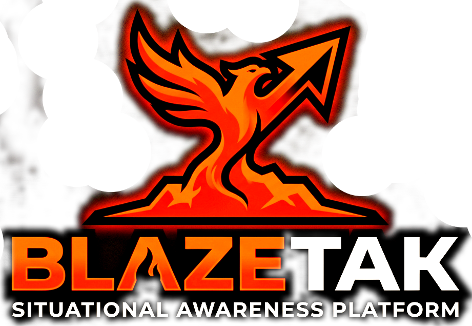

# <p align="center"><br><code>BLAZE•TAK</code></p>

<p align="center">
  <strong>🔥 The Open-Source TAK Replacement Built for Airsoft &amp; MilSim 🔥</strong>
</p>

<p align="center">
  <em>A free, self-hosted Team Awareness Kit platform giving tactical teams real-time shared maps, GPS tracking, and MIL-STD-2525 symbology — right in the browser.</em>
</p>

<p align="center">
  <em>Built with modern .NET 10, Blazor Interactive Auto/WebAssembly, SignalR, PostGIS, and MIL-STD-2525 Symbology.</em>
</p>

<p align="center">
  <a href="#-key-features"></a>
  <a href="#-tech-stack"></a>
  <a href="#-tech-stack"></a>
  <a href="#-tech-stack"></a>
  <a href="#-tech-stack"></a>
  <a href="#-tech-stack"></a>
</p>

---

## 🛰️ Overview

**BlazeTAK** is a free and open-source alternative to the TAK ecosystem (ATAK, WinTAK, iTAK, CivTAK). It is designed and built for **airsoft, milsim, and airsoft-adjacent tactical communities** — game organizers, squad leaders, and players who want real map-based team coordination without proprietary software, locked-down ecosystems, or native client installations.

All you need is a browser. Players throw a web page open on their phone, share their GPS, see teammates and objectives on the map, and coordinate in real time — while admins run the whole thing from a single self-hosted server they fully control.

- 🎯 **Made for airsoft & milsim:** purpose-built for the demands of weekend events, 24h milsim operations, and year-round clubs — not defense contracting.
- 🕸️ **Zero-install client:** nothing to side-load or activate; the tactical map is a web app.
- 🏠 **Self-hosted & air-gap friendly:** run it on cheap cloud infrastructure, a NAS at the game field, or an offline field server during games — your operational data never leaves hardware you own.
- 🆓 **Open source:** no license keys, no subscriptions, no telemetry. Community contributions welcome.

Engineered with high-contrast, low-light tactical UI principles (`#000000` pitch black, `#ff5521` blaze orange, and `#2d4fad` tactical blue), BlazeTAK is optimized for both tactical monitors and mobile field terminals.

```
┌────────────────────────────────────────────────────────────────────────────────────────┐
│                                  BLAZETAK ARCHITECTURE                                 │
├─────────────────────────┬───────────────────────────────┬──────────────────────────────┤
│   TACTICAL WEB CLIENT   │      SIGNALR / REST API       │      SPATIAL PERSISTENCE     │
│   Blazor WASM + Leaflet │  ◄─► Hub Synchronization ◄──► │  PostgreSQL 16 + PostGIS     │
│   MIL-STD-2525 Symbols  │      Tactical Channel Routing │  EF Core Spatial Context     │
└─────────────────────────┴───────────────────────────────┴──────────────────────────────┘
```

---

## ⚡ Key Features

<table>
  <thead>
    <tr>
      <th width="35%">Feature</th>
      <th width="65%">Description</th>
    </tr>
  </thead>
  <tbody>
    <tr>
      <td><strong>🗺️ Live Tactical Map (LiveMap)</strong></td>
      <td>Interactive geospatial view powered by Leaflet and OpenTopoMap with high-precision terrain contours, coordinate grids, and live overlay rendering.</td>
    </tr>
    <tr>
      <td><strong>⚡ Real-Time Hub Synchronization</strong></td>
      <td>Instant bi-directional marker placement, positional updates, and unit telemetry distribution via <code>MapHub</code> SignalR web sockets.</td>
    </tr>
    <tr>
      <td><strong>🎖️ MIL-STD-2525 Symbology</strong></td>
      <td>Native military symbology generation via <code>milsymbol.js</code> supporting SIDC designations, affiliation coloring (Friendly, Hostile, Neutral, Unknown), and cluster badge counts.</td>
    </tr>
    <tr>
      <td><strong>📡 GPS & Field Telemetry</strong></td>
      <td>Real-time device GPS integration with continuous breadcrumb tracking, speed/bearing reporting, and tactical squad visualization.</td>
    </tr>
    <tr>
      <td><strong>📍 Precision Marker Controls</strong></td>
      <td>Drag-and-drop repositioning, interactive placement mode crosshairs, right-click context menus, custom metadata, and persistent vs. temporary markers.</td>
    </tr>
    <tr>
      <td><strong>👥 Squad & Group Channels</strong></td>
      <td>Multi-group partition support allowing isolated tactical nets, HQ squad coordination, and selective situational filtering.</td>
    </tr>
    <tr>
      <td><strong>🔐 Identity & Access Control</strong></td>
      <td>ASP.NET Core Identity with 2FA, passkeys, secure token authentication, and role-based permissions.</td>
    </tr>
    <tr>
      <td><strong>🐳 Cloud & Air-Gapped Deployments</strong></td>
      <td>Multi-stage containerization with Docker Compose for rapid cloud hosting or self-contained field server deployment.</td>
    </tr>
  </tbody>
</table>

---

## 🎖️ Built for Airsoft & MilSim

| Use case | How BlazeTAK helps |
| :--- | :--- |
| **Event command & control** | Game admins track objectives, spawn points, and unit positions live from a single dashboard — no more radio confusion about "who is where." |
| **Squad coordination** | Players see their own squad on the map in real time, mark contacts (hostile) or rally points (friendly), and stay oriented on large event sites. |
| **24h+ milsim operations** | Multi-day events benefit from persistent markers, group channels, and breadcrumb tracking to literally watch the battle lines move overnight. Isolated tactical nets keep intel compartmentalized between factions. |
| **Pre-planned scenario briefings** | Place persistent POIs, objectives, and boundaries before the event so every player loads in with the same shared operational picture. |
| **Club & community infrastructure** | Run your own tactical server year-round for your club. Free open-source software, plain HTML/JS interop, and standard hardware are all you need. |

> ⚠️ **Safety first:** BlazeTAK is a game-support tool for airsoft and milsim. It is *not* certified for real-world military, SAR, or emergency use, and GPS sharing only works within network coverage of your server.

---

## 🎨 Tactical Design Palette

BlazeTAK adheres strictly to the **Tactical High-Contrast Dark** specification:

| Role | Color | Hex Code | Purpose |
| :--- | :---: | :---: | :--- |
| **Primary Background** |  `Pitch Black` | `#000000` | Night-vision friendly, OLED battery optimization, zero glare |
| **Tactical Front / Accent** |  `Blaze Orange` | `#ff5521` | High-visibility primary telemetry, borders, active indicators |
| **Tactical Highlight** |  `Cobalt Blue` | `#2d4fad` | Active controls, focus rings, secondary status highlights |
| **Secondary Background** |  `Obsidian` | `#111111` | Card headers, elevated panels, modal backgrounds |

---

## 🛠️ Tech Stack

- **Framework:** [.NET 10](https://dotnet.microsoft.com/) (C# 14)
- **UI Architecture:** [Blazor](https://dotnet.microsoft.com/apps/aspnet/web-apps/blazor) (Interactive Auto & Interactive WebAssembly)
- **Real-Time Layer:** [ASP.NET Core SignalR](https://learn.microsoft.com/aspnet/core/signalr/introduction)
- **Mapping & GIS:** [Leaflet.js](https://leafletjs.com/) + [OpenTopoMap](https://opentopomap.org/)
- **Military Symbology:** [milsymbol](https://github.com/spatialillusions/milsymbol) (MIL-STD-2525 / APP-6)
- **Database:** [PostgreSQL 16](https://www.postgresql.org/) with [PostGIS](https://postgis.net/) Spatial Extension
- **ORM:** [Entity Framework Core 10](https://learn.microsoft.com/ef/core/) (Npgsql.EntityFrameworkCore.PostgreSQL.NetTopologySuite)
- **Styling:** Custom Tactical Dark Theme & [Bootstrap 5](https://getbootstrap.com/)
- **Containerization:** [Docker](https://www.docker.com/) & [Docker Compose](https://docs.docker.com/compose/)

---

## 🚀 Quick Start (Docker)

The fastest way to deploy BlazeTAK with a full PostGIS database and real-time backend is via Docker Compose:

### 1. Clone the repository
```bash
git clone https://github.com/Borik007/BlazeTAK.git
cd BlazeTAK
```

### 2. Launch with Docker Compose
```bash
docker compose up -d
```

### 3. Access BlazeTAK
- **Web Application:** `http://localhost:5000` (or configured container port)
- **PostGIS Spatial Database:** `localhost:5432` (`blazetak` / `blazetak_dev`)

---

## 💻 Local Development Setup

### Prerequisites
- [.NET 10 SDK](https://dotnet.microsoft.com/download/dotnet/10.0)
- [PostgreSQL](https://www.postgresql.org/) with PostGIS extension (or run PostgreSQL container from `compose.yaml`)
- Modern Web Browser (Chrome, Firefox, Edge, Safari)

### 1. Start Database Container
```bash
docker compose up -d postgres
```

### 2. Apply Database Migrations
```bash
dotnet ef database update --project BlazeTAK/BlazeTAK/BlazeTAK.csproj
```

### 3. Run the Solution
```bash
dotnet run --project BlazeTAK/BlazeTAK/BlazeTAK.csproj
```

Navigate to `https://localhost:7145` or `http://localhost:5145` in your browser.

---

## 📐 Project Structure

```text
BlazeTAK/
├── BlazeTAK/
│   ├── BlazeTAK/                      # ASP.NET Core Host & Server Components
│   │   ├── Components/                # Razor Components & Pages
│   │   │   ├── Account/               # Authentication & User Management
│   │   │   ├── Layout/                # NavMenu & MainLayout Tactical Chrome
│   │   │   └── Pages/                 # Server-rendered Landing & Error Pages
│   │   ├── Hubs/                      # SignalR MapHub Real-time Dispatcher
│   │   ├── Models/                    # EF Core Entities (Markers, Groups, Messages)
│   │   ├── Services/                  # Business Logic & Tactical Sync Services
│   │   └── wwwroot/                   # Tactical Stylesheets (app.css) & Icons
│   │
│   ├── BlazeTAK.Client/               # Blazor WebAssembly Client Application
│   │   ├── Pages/                     # Tactical Client Views (LiveMap.razor, Groups)
│   │   ├── Models/                    # Shared DTOs & Tactical Marker Schemas
│   │   └── wwwroot/js/                # Leaflet & milsymbol Interop (livemap.js)
│   │
│   └── BlazeTAK.Tests/                # Automated Unit & Integration Test Suites
│
├── compose.yaml                       # Multi-container Deployment Orchestration
└── README.md                          # Repository Documentation
```

---

## 🎯 Usage Guide

1. **Sign In / Select Group:**
   - Register or login to establish your operator identity.
   - Join your assigned squad or tactical operating group.
2. **Access LiveMap:**
   - Click **LiveMap** in the tactical sidebar.
   - View active friendly units, placed points of interest, and telemetry streams.
3. **Placing & Managing Markers:**
   - Select a symbol from the **Toolbox** (Friendly HQ, Hostile Infantry, Observation Post, etc.).
   - Click anywhere on the map grid to place the marker with instantaneous team broadcast.
   - Right-click any marker to **Move**, **Edit Details**, or **Delete**.
4. **GPS Broadcast:**
   - Toggle **GPS Tracking** in the LiveMap status bar to share real-time position updates with your unit.

---

## 🔒 Security & Compliance

- **Identity Management:** Multi-factor authentication (2FA), password policies, and passkey authentication support.
- **Geospatial Privacy:** Group-scoped marker broadcasting ensures operational compartmentalization.
- **Data Protection:** Standardized TLS encryption for all SignalR web socket connections and REST endpoints.

---

## 🤝 Contributing

BlazeTAK is an open-source community project for the airsoft &amp; milsim community. Contributions are welcome:

1. Fork the repository and create a feature branch.
2. Implement your change (with tests in `BlazeTAK.Tests/` where practical).
3. Open a pull request describing the tactical problem you're solving.

Bug reports, event feedback from the field, and feature requests are equally valuable — if something breaks mid-game, we want to know.

---

<p align="center">
  <sub>BlazeTAK — real-time tactical awareness for airsoft &amp; milsim teams. Stay oriented. 🔥</sub>
</p>
